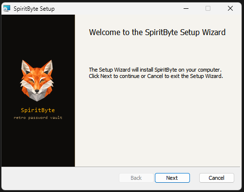
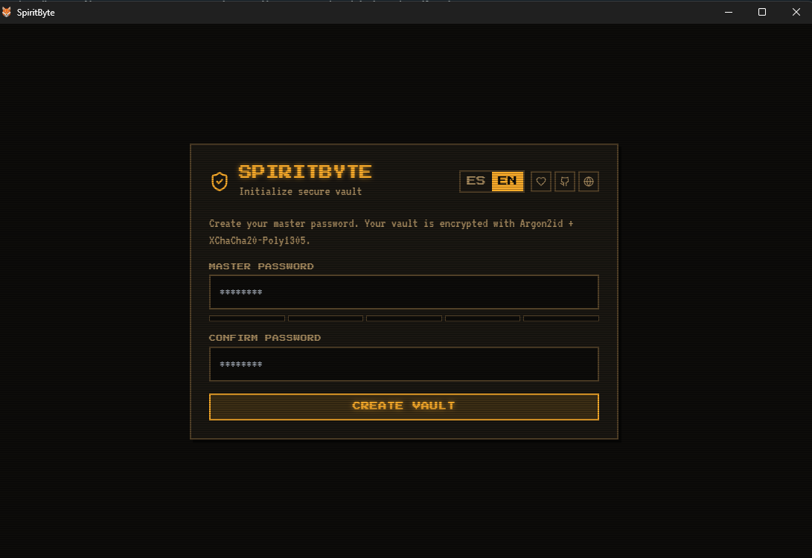
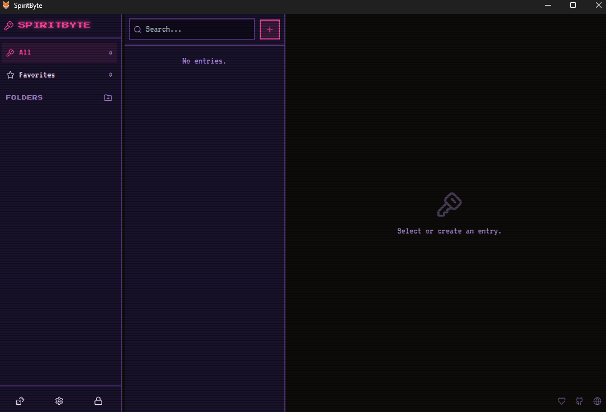
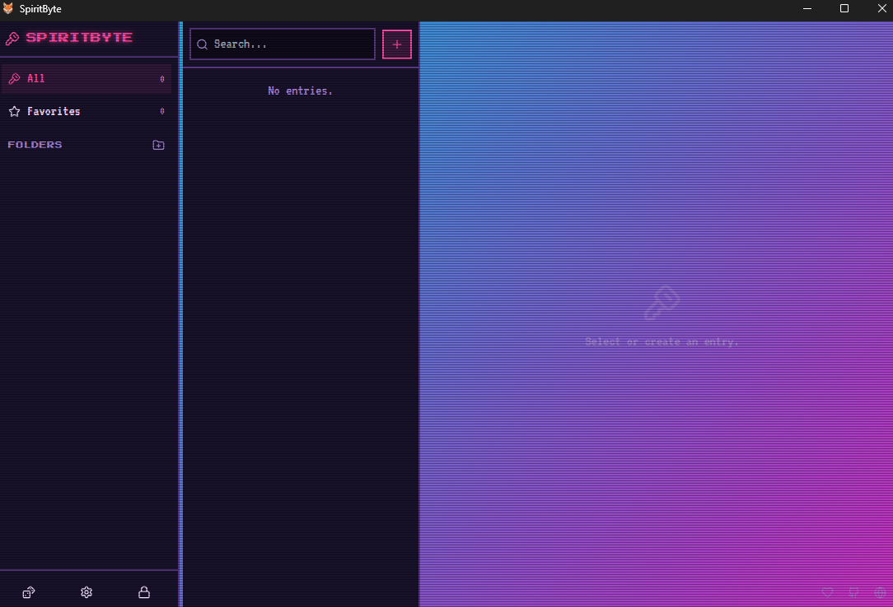
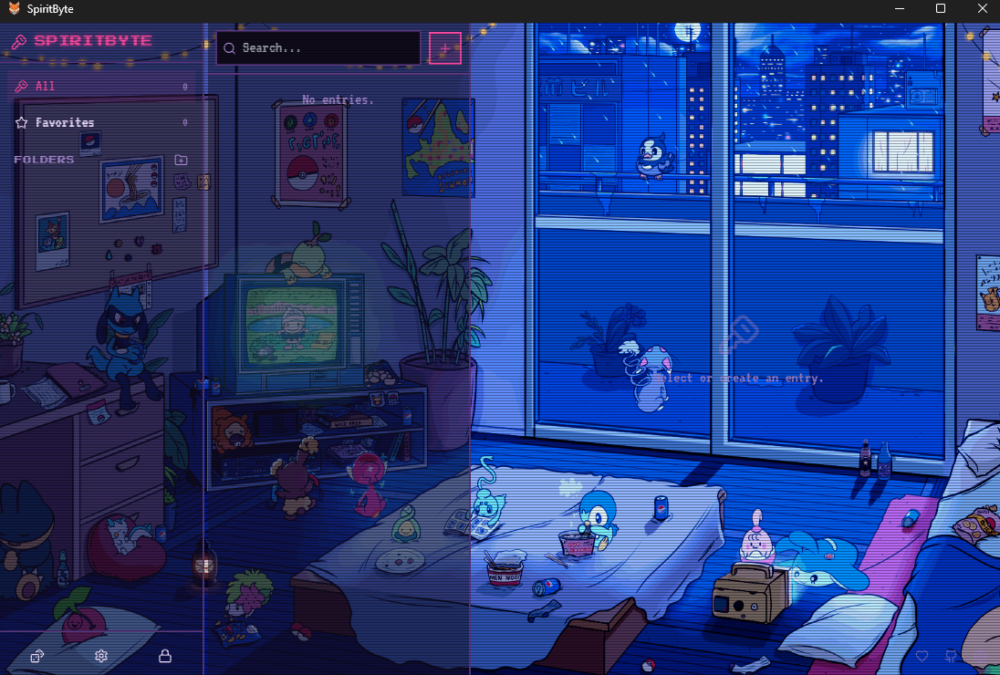

<div align="center">

# SpiritByte

### Local-first retro password manager

A secure, fully customizable password manager with a retro CRT/pixel aesthetic. Windows/macOS use Tauri 2 + React/TypeScript; Linux uses a separate native GTK 3 client in Rust. Both share the same vault engine. Your data never leaves your device.

[](https://v2.tauri.app/)
[](https://www.rust-lang.org/)
[](https://react.dev/)
[](https://www.typescriptlang.org/)
[](LICENSE)

[Features](#features) &middot; [Backups](#encrypted-backups) &middot; [Performance](#performance) &middot; [Security](#security-model) &middot; [Install](#installation) &middot; [Build](#building-from-source) &middot; [Architecture](#architecture)

</div>

---

## Screenshots

<table>
  <tr>
    <td width="50%" align="center"><b>MSI Installer (WiX)</b></td>
    <td width="50%" align="center"><b>Onboarding — Master Key Setup</b></td>
  </tr>
  <tr>
    <td></td>
    <td></td>
  </tr>
</table>

<details>
<summary>Theme customization</summary>

<table>
  <tr>
    <td width="33%" align="center"><b>Solid</b></td>
    <td width="33%" align="center"><b>Gradient</b></td>
    <td width="33%" align="center"><b>Image / GIF</b></td>
  </tr>
  <tr>
    <td></td>
    <td></td>
    <td></td>
  </tr>
</table>

</details>

## Features

**Cryptography**
- Argon2id key derivation + XChaCha20-Poly1305 authenticated encryption
- Envelope encryption: a random DEK encrypts the vault, wrapped twice (master password + BIP39 recovery phrase)
- 12-word BIP39 recovery phrase for full access recovery
- All secrets are zeroized in memory — the DEK and master password never leave the Rust process

**Vault Management**
- Entries with title, username, password, URL, and notes
- Nested folders with custom icons and colors
- Favorites, full-text search, and keyboard-driven workflow
- Selectable notes with a one-click copy-all button
- Password-protected encrypted vault import/export from Settings
- Configurable password generator with entropy strength meter
- Auto-lock on inactivity and automatic clipboard clearing

**Customization**
- Multiple preset palettes + custom color editor (live preview)
- Retro typography (Press Start 2P, VT323, Geist Pixel) with adjustable font size
- Backgrounds: solid, gradient, or custom image
- CRT effects: scanlines, glow, flicker, and Bayer 8x8 dithered splash screen

**Cross-platform**
- Native installers for Windows (MSI via WiX, NSIS), macOS, and Linux
- Android version available: [SpiritByte for Android](https://github.com/OscarTired/SpiritByte-Android), built with native Kotlin/Compose and the shared Rust vault engine
- Multilingual: English and Spanish with runtime switching

> [!TIP]
> SpiritByte stores everything locally in your OS app-data directory. No servers, no accounts, no telemetry. Your encrypted vault is the only artifact that matters.

## Security Model

| Artifact | Contents | Encryption |
|---|---|---|
| `vault.dat` | Entries and folders | XChaCha20-Poly1305 (DEK) |
| `vault.meta.json` | Salts, Argon2 params, wrapped DEK (x2) | No plaintext secrets |
| `settings.json` | UI preferences | Plaintext (non-sensitive) |

```
Master Password ──┐
                  ├──(Argon2id)──> DEK ──> XChaCha20-Poly1305 ──> vault.dat
Recovery Phrase ──┘
```

> [!WARNING]
> If you lose **both** your master password **and** your 12-word recovery phrase, the vault is unrecoverable by design. There is no backdoor.

## Encrypted backups

Choose **All** to export the entire vault, or **Select** to choose folders and individual credentials. Checking a folder selects its contents and subfolders; uncheck any individual credentials to exclude them. Required parent folders, icons and colors are preserved automatically. Explicitly selected empty folders can also be exported. **Clear** resets the selection, and an empty selection cannot be exported.

In **Settings > Import / Export vault**, choose a long, unique backup password (at least 12 characters), use the strength meter as guidance, confirm it, and export to a new `.spiritbyte` file using the native save dialog. The live character counter and matching-password indicator show when export is enabled; the strength estimate is advisory. Keep the password separately: the vault recovery phrase cannot unlock this backup. Existing files are never overwritten.

To restore, create or unlock a destination vault, select the backup in Settings, enter its backup password, and choose **Import and add**. All entries (including notes, favorites, timestamps and icons), folders and parent relationships are preserved. Imported records receive fresh IDs, so existing records are retained; importing twice creates duplicates. Visual preferences, wallpapers, master credentials and recovery phrases are not included. The destination vault keeps its own credentials.

Format v1 uses fixed Argon2id parameters (64 MiB, 3 iterations, 1 lane), a fresh random salt, and XChaCha20-Poly1305 authenticated encryption with a fresh nonce. No decrypted backup is written to disk. Imports are limited to 32 MiB and authenticated and structurally validated before merging. The encrypted vault is synced to a sibling temporary file and atomically replaced before the session is updated.

## Performance

The following frontend notes describe the Tauri client. The native Linux client
uses event-driven GTK rendering, one process and the shared Rust core; see the
[Linux installation](#linux--cachyos--native-gtk) section.

On the CachyOS/Hyprland laptop (2026-10-05), the native release measured
**32.5 MiB PSS / 60.1 MiB summed RSS** with a solid background, glow and scanlines,
and **37.1 MiB PSS / 63.2 MiB summed RSS** with the two-frame GIF fixture plus
scanlines, glow and flicker. Both used 15 seconds of warmup and 20 seconds of
sampling, with resource saving off and disposable data. The solid screen used
0.00% of one CPU core; the active GIF/effects used 14.84%. The GIF's two rendered
frames were also checked after the sample. The previous WebKit client used about
250 MiB PSS / 385 MiB summed RSS in the solid-background comparison below.
The fixture measures the runtime baseline; larger photos/GIFs and an unlocked
vault add their own decoded surfaces/data.

- Search sorting and normalized text are cached until entries change, avoiding repeated sorting while typing or switching folders.
- Entry and folder saves update the affected frontend records without fetching the entire vault again. Unchanged entry rows reuse their rendered output.
- Password strength checks are debounced, and the inactivity timer tracks activity without recreating a timeout on every mouse movement.
- The splash precomputes its shaded Bayer-dithered fox once, then reveals the cached artwork. Its vector facets, subtle phosphor glow and scan sweep follow the active palette; reduced-motion preferences skip the sweep.
- CRT flicker is off by default to keep the interface idle. If enabled in Appearance, it uses discrete pulses instead of continuously interpolating the entire window. Scanlines use one overlay, and reduced-motion preferences disable flicker.
- **Save resources** is enabled by default on Linux, including existing preferences that do not yet specify this option. It suppresses flicker and unloads GIF/WebP backgrounds on blur, restoring them on focus. Static photos stay visible in inactive windows; hiding the window unloads all image backgrounds. Disable it in Appearance if you want the background visible while working in another window.
- Wallpapers use the native desktop file picker with explicit PNG/JPG/GIF/WebP/BMP filters and an all-files fallback. Rust streams the selected file directly into app data (32 MiB limit), detects its format from the contents, and keeps the previous background until the new image can be decoded. Images are no longer expanded into a JavaScript number array or reloaded when unrelated settings change.
- The asset protocol allows `$APPDATA/wallpaper.*` explicitly. On Linux, broad globs do not match hidden directory components such as `.local`; the explicit app-data path lets imported backgrounds load without exposing vault or settings files.
- Linux release builds use the JavaScriptCore interpreter to avoid JIT compiler pages/caches; cryptography remains native Rust. Set `JSC_useJIT=true` before launching to restore JIT for unusually large vaults. WebKit uses on-demand hardware compositing, the document-viewer cache model, no browsing-history page cache, and disables unused WebGL/audio/video APIs. Canvas, GIFs and CRT effects remain supported. These reduce allocation; the WebKit runtime and decoded image surfaces still have a memory cost, and actual CPU/RAM use depends on the graphics stack and the selected GIF.
- Screens and optional dialogs load on demand. Closing the entry editor or generator unmounts its state, and the splash releases its decoded source and canvas buffers when finished. Palettes, fonts, effects and wallpapers remain available. These changes reduce eager work, but do not remove WebKit's base memory cost.
- Pending saves and refreshes cannot repopulate the frontend after locking. Vault writes use atomic replacement, and failed saves retain the previous data.

**Legacy WebKit comparison:** On CachyOS/Hyprland (2026-10-05), a release AppImage comparison with the same bundled runtime, a solid background, glow/scanlines and resource saving off measured **249.9 → 244.6 MiB PSS** and **385.4 → 380.0 MiB summed RSS** after a 15-second warmup and 20-second sample. This small difference can overlap run variation: these changes **do not deliver a substantial idle RAM reduction or Windows-like memory usage**. The WebKit renderer/network processes remain the main cost. A software-rendering fallback reduced memory but increased idle CPU significantly, so it is not forced. GIF animation was checked with two different rendered frames; the production UI searched 1,000 fictitious entries in approximately 37 ms. These fixture results are not a guarantee for every wallpaper or vault.

## Installation

### Pre-built binaries

Download the latest installer from the [Releases](https://github.com/OscarTired/SpiritByte-V2/releases) page:

| Platform | Installer |
|---|---|
| Windows | `.msi` (WiX) or `-setup.exe` (NSIS) |
| macOS | `.dmg` |
| Linux | Native GTK `.tar.gz` (this source); older releases used `.deb` / `.AppImage` |
| Android | See [SpiritByte-Android](https://github.com/OscarTired/SpiritByte-Android) for downloads and build instructions |

### Linux / CachyOS — native GTK

Linux now builds `linux-native/`: one native Rust/GTK process, with **no WebKit,
JavaScriptCore, React or Node runtime**. Windows keeps its existing Tauri UI and
build commands. The native client reads the same `com.spiritbyte.app` data directory,
vault format, recovery phrase, encrypted backups and visual settings; no vault
migration or plaintext export is needed.

Build and install on CachyOS:

```bash
sudo pacman -S --needed base-devel rust gtk3 fontconfig
cargo test --manifest-path linux-native/Cargo.toml --locked
cargo test --manifest-path core/Cargo.toml
cargo build --manifest-path linux-native/Cargo.toml --release --locked
bash scripts/linux/package-native.sh linux-native/target/release/spiritbyte linux-native/target/release/bundle
bash scripts/linux/install-native.sh linux-native/target/release/bundle/SpiritByte_0.1.2_linux-native_x86_64
```

The native archive includes an executable, icon, installer and font licenses.
GTK/display libraries come from the host, avoiding old bundled Wayland/Mesa
conflicts. The installer checks shared libraries, installs to
`~/Applications/SpiritByte/spiritbyte` and replaces the same application-launcher
entry. It retires `~/Applications/SpiritByte.AppImage` to
`$XDG_DATA_HOME/spiritbyte-install-backups/` for rollback. It never changes or
deletes the vault, settings or wallpaper files. Close the previous app before
updating. Legacy AppImage scripts remain for earlier builds.

The GTK vault follows the Windows three-pane layout: folders and favorites on the
left, search and credentials in the middle, and a selectable detail view on the
right. Both dividers can be resized. Appearance, security and encrypted backups
are grouped in Settings. Embedded TTF copies of the existing retro fonts load
through Fontconfig/Pango without installing fonts on the system. CRT effects
paint on the existing container instead of adding an input-blocking window.

The native layout provides entries, nested folders, favorites, search, generator,
master-password changes/recovery, encrypted imports/exports, English/Spanish,
auto-lock and clipboard expiration. Use Ctrl/Shift to select multiple rows for
export. The current-folder export includes descendants and empty folders; with a
search query it exports the visible matching entries.

Photos and animated GIFs are decoded directly, with bounded image surfaces.
PNG/JPEG/BMP use GdkPixbuf; static WebP also has a built-in fallback when the
system lacks a WebP loader. GIFs use an incremental Rust decoder that keeps only
working frames, paints at most 20 FPS and invalidates changed rectangles instead
of repainting every pane. Preset/custom colors, retro fonts, gradients, panel
opacity, glow, scanlines and optional discrete flicker are supported. The Windows
phosphor-fox intro also runs in native Cairo, releases its artwork and timer after
3.2 seconds, and can be disabled in Appearance.
The folder-section plus creates a folder; a pencil beside each folder edits its
name, parent, icon and color. Removing the automatic “No folder” filter hides it
without deleting credentials; Appearance can restore it.
In power-saving mode, an unfocused/minimized window pauses GIF/flicker timers;
static photos remain visible. Costly password derivations and backup cryptography
run on worker threads. Locking clears the session, closes secret editors, clears
owned clipboard text and rejects late unlock results. GTK buffers are cleared
before disposing secret forms; the shared core continues zeroizing its secrets.

For an isolated end-to-end native UI check (never your real vault):

```bash
cargo build --manifest-path linux-native/Cargo.toml --release --features ui-check --locked
python scripts/linux/check-native-ui.py linux-native/target/release/spiritbyte --output linux-native/target/validation/ui.json
# Run separately: pointer/keyboard events and window-only screenshots on Hyprland.
python scripts/linux/check-native-interaction.py linux-native/target/release/spiritbyte --output .impeccable/review
python scripts/linux/check-native-interaction.py linux-native/target/release/spiritbyte --output .impeccable/review/onboarding --onboarding
python scripts/linux/check-native-lifecycle.py linux-native/target/release/spiritbyte --output .impeccable/review/lifecycle.json --assert-stable
# Rebuild without the opt-in checker before packaging/installing.
cargo build --manifest-path linux-native/Cargo.toml --release --locked
python scripts/linux/measure-memory.py linux-native/target/release/spiritbyte --native --size 1100x720
python scripts/linux/check-native-gif.py linux-native/target/release/spiritbyte
```

The checker uses disposable XDG data, 1,000 fictitious credentials, actual encrypted
saves/backups, nested-folder filtering, clipboard expiry, inactivity locking and
late-unlock rejection. On Hyprland it captures only its own test window and checks
two rendered GIF frames. Memory measurements report the entire process tree's PSS,
summed RSS and CPU; compare the same screen/background and avoid overlapping runs.

**Reset a forgotten master key**

If you saved your 12-word recovery phrase, use the recovery option on the unlock
screen to reset your password while preserving the vault. Otherwise, close the
app and move its data directory aside to start a new vault:

```bash
bash -c 'data="${XDG_DATA_HOME:-$HOME/.local/share}/com.spiritbyte.app"; if [ -d "$data" ]; then mv -T -- "$data" "$data.backup-$(date +%s)"; fi'
```

This preserves the old encrypted vault in a timestamped backup directory. The next
launch asks you to create a new master key. The previous data still requires its
original password or recovery phrase; creating a new vault does not unlock it.
Preferences are also reset. To remove only the existing vault permanently instead,
delete `vault.dat` and `vault.meta.json` from that data directory while the app is
closed.

### Updating on Windows

For version 0.1.1, close SpiritByte and run the new installer using the same installer format as your current installation (MSI or NSIS EXE). Install over the existing version; there is no need to uninstall first. The application identifier and MSI upgrade code remain unchanged, and the vault stays in the existing app-data directory. The `src-tauri/target` directory contains build artifacts only and is regenerated when building.

### Building from source

**Prerequisites**

- [Node.js](https://nodejs.org/) 18+ and [pnpm](https://pnpm.io/)
- [Rust](https://www.rust-lang.org/tools/install) toolchain (`cargo`)
- Platform-specific Tauri [prerequisites](https://v2.tauri.app/start/prerequisites/)

**Windows/macOS development**

```bash
pnpm install
pnpm tauri dev
```

**Windows/macOS production build**

```bash
pnpm tauri build
```

On Windows, Tauri produces the existing MSI/NSIS installers. Linux builds the separate GTK client as described below; it does not need Node.js or WebKitGTK.

**Build Linux packages from Windows with Docker Desktop**

Start Docker Desktop with Linux containers enabled, then run from the desktop project in PowerShell. The Rust core is included in this repository; no Android checkout is required:

```powershell
./scripts/build-linux.ps1
```

The builder uses Ubuntu 22.04 and compiles the local Rust core and native GTK client.
It writes the native directory and `.tar.gz` archive to
`linux-native/target/release/bundle/`. It does not build or change Windows installers.
The first build downloads the toolchain; subsequent builds reuse Docker caches.
One compiler job limits peak build memory. For a direct CachyOS build, follow
[the native Linux instructions](#linux--cachyos--native-gtk).

**Run crypto tests**

```bash
cargo test --manifest-path core/Cargo.toml --locked
```

**Legacy Tauri wallpaper regression (optional)**

With the Linux Tauri build prerequisites installed and an active graphical session:

```bash
pnpm build
cargo build --manifest-path src-tauri/Cargo.toml --release --features tauri/custom-protocol --example wallpaper_asset_check --locked
python3 scripts/linux/check-wallpaper-assets.py
```

This launches hidden test windows with disposable XDG directories containing `.local`.
It reproduces the former scope failure, then checks actual WebKit decoding of PNG,
JPG, GIF, WebP and BMP with the corrected scope. Fake vault/settings probes remain
outside the asset scope; the check never opens the real vault. The test executable
is not included in the installed AppImage.

**Legacy Tauri UI regression (optional)**

```bash
CARGO_BUILD_JOBS=1 cargo build --manifest-path src-tauri/Cargo.toml --release --features tauri/custom-protocol --example linux_ui_check --locked
python3 scripts/linux/check-linux-ui.py
```

This opens the production UI with 1,000 fictitious entries, a two-frame GIF and
scanlines/glow/flicker enabled. On Hyprland, `grim`, `hyprctl` and Python Cairo
check changing pixels in a crop of the test window. Other desktops check GIF
decoding and UI behavior. All data is disposable; the real vault is never opened.

**Measure release memory on the laptop**

```bash
python3 scripts/linux/measure-memory.py /path/to/SpiritByte.AppImage --output memory.json
```

The script waits 15 seconds, samples the entire process tree for 20 seconds and
reports CPU, PSS and summed RSS. PSS apportions shared pages; summed RSS counts
shared pages repeatedly. It uses temporary XDG settings with glow and scanlines,
keeps resource saving off, and never accesses the real vault. Use `--flicker` or
`--wallpaper /path/to/image.gif` to compare those effects under identical conditions.

The vault engine is the standalone `spiritbyte-core` Rust library in this
repository's `core/` directory. Desktop builds use only this local copy and do
not require the Android repository or Android SDK. Android includes its own copy
of the same library so it can also build independently.

`src-tauri/src/{crypto,vault,backup,generator}.rs` are compatibility re-exports.
Make engine changes in `core/src`. When changing the engine, apply the same
source and dependency changes to Android's `core/` and run the core tests in both
repositories to preserve vault and backup compatibility. Copies do not synchronize
automatically. See [the core library README](core/README.md).

## Architecture

```
linux-native/              Linux-only native GTK client (Rust)
  src/main.rs              Native forms, vault UI, security timers, worker jobs
  src/background.rs        Bounded image decoding and event-driven GIF rendering
  src/model.rs             Shared-core transactions and compatible settings
  src/fonts.rs             Process-local embedded font registration
  src/ui_check.rs          Opt-in isolated end-to-end checker

src/                       Windows/macOS frontend (React + TypeScript)
  components/              UI primitives, SplashFox, StrengthMeter
  features/                generator, entries, settings
  screens/                 Onboarding, Unlock, VaultApp
  store/                   Zustand state (useVault, useSettings)
  theme/                   Palettes + theme application (CSS vars)
  lib/                     API bridge, clipboard, auto-lock, types

core/                      Standalone spiritbyte-core library (included locally)
  src/crypto.rs            Argon2id, XChaCha20-Poly1305, BIP39
  src/vault.rs             Data model, on-disk format, operations
  src/backup.rs            Encrypted portable backups and additive restore
  src/generator.rs         Password generator + strength estimation
  tests/                   Export selection integration tests

src-tauri/src/             Desktop backend (Rust)
  {crypto,vault,backup,generator}.rs  Core compatibility re-exports
  state.rs                 Session state (DEK in memory)
  commands.rs              Tauri IPC commands exposed to frontend
```

<details>
<summary>Tech stack</summary>

| Layer | Technology |
|---|---|
| Desktop runtime | GTK 3 (Linux), Tauri 2 (Windows/macOS) |
| Backend | Rust (argon2, chacha20poly1305, bip39, zeroize) |
| Frontend | React 18, TypeScript 5.6 |
| State | Zustand 5 |
| Styling | Tailwind CSS 3.4 |
| Icons | Lucide React |
| Fonts | Press Start 2P, VT323, Geist Pixel (5 variants) |

</details>

## Roadmap

- [x] Password-protected encrypted vault import/export (`.spiritbyte`)
- [x] Search, rendering, clipboard feedback and inactivity-timer improvements
- [ ] Browser extension autofill

## Contributing

Contributions are welcome. Please open an issue first to discuss what you would like to change.

1. Fork the repository
2. Create a feature branch (`git checkout -b feat/my-feature`)
3. Commit your changes
4. Open a pull request

## Support

If you find SpiritByte useful, consider supporting the project:

[](https://paypal.me/octacodec)
[](https://github.com/OscarTired)
[](https://octa-dev.com/)

## License

[MIT](LICENSE)
